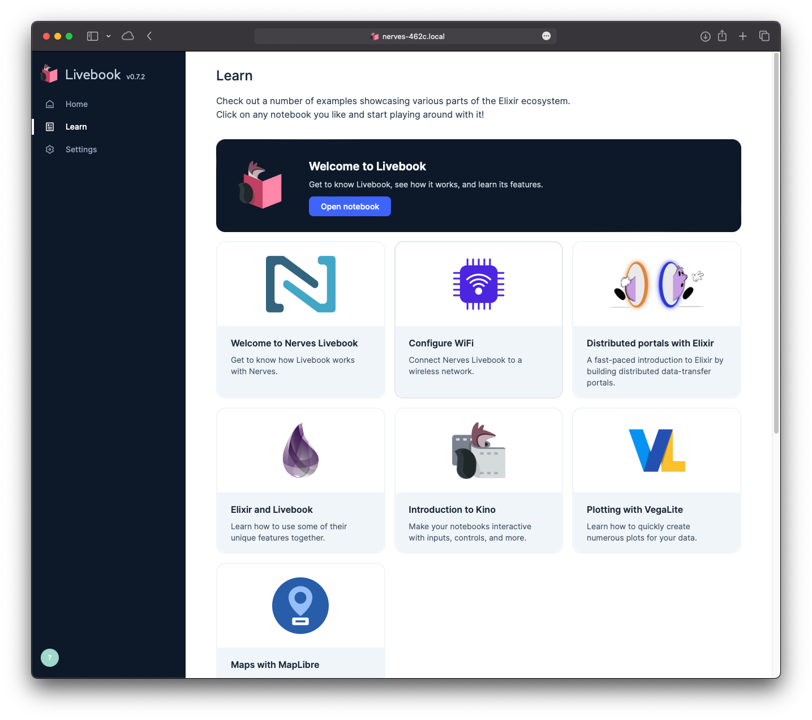

---
# A template example, not a real post. It is a draft, so it never publishes; `bin/server -D`
# shows drafts, at /blog/2026-11-27-example-post/. Copy this file to start a new post.
# The front matter fields are documented in content/blog/_index.md.
title: "Example post: how a blog post looks"
date: 2026-11-27
draft: true
description: >-
  A template example that shows every part of a blog post: headings, a list, a code block,
  an image and a quote. Copy it to start a new post.
author: The Nerves team
author_initials: "N"
role: Template example
author_bio: >-
  This is where the writer gets a sentence or two: who they are and what they build with
  Nerves. Leave out `author_bio` and this card goes away.
author_links:
  - name: GitHub
    url: https://github.com/nerves-project
---

This is a template example, not a real post. It shows how each part of a post looks on the
site, so a new post can start from a copy of this file. The opening paragraph is the place to
say what the post is about and who it is for.

## Headings make the outline

Every `##` heading becomes an entry in the "On this page" rail next to the post. Keep them
short, and use `###` for anything below that.

### A smaller heading

Smaller headings are left out of the rail. They are good for steps or sub-topics.

## Lists

A post can use the usual Markdown lists:

- Short points, one line each
- Links, like the [Nerves documentation](https://hexdocs.pm/nerves)
- `inline code` for module and function names

1. Numbered steps work too
2. Each one a single action

## Code

Code fences get syntax highlighting and a copy button. Add a file name to show it in the bar
above the code:

```elixir {filename="lib/my_app/application.ex"}
def start(_type, _args) do
  children = [MyApp.Sensors, MyApp.Uplink]
  {:ok, sup} = Supervisor.start_link(children, strategy: :one_for_one)

  # The important parts are up, so keep this firmware
  Nerves.Runtime.validate_firmware()
  {:ok, sup}
end
```

## Images and quotes

Images go in `static/img/blog/` and get a caption when they are wrapped in a figure:

<figure>
  
  <figcaption>A caption says what the picture shows. This one is Nerves Livebook running on a device.</figcaption>
</figure>

> A quote from someone, or a line worth pulling out of the text, goes in a blockquote.

The end of the post is followed by the author card, the previous and next entries on the blog,
and the newsletter signup.
