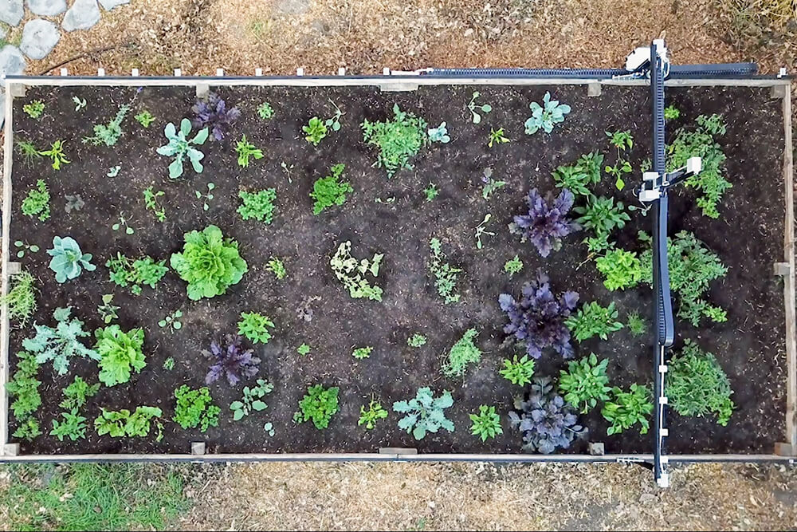

## The concept

FarmBot is an open-source precision agriculture CNC farming project that
includes a robot farming machine, software, and documentation including a
farming data repository. FarmBot’s machines use IoT technology to make it easy
for farmers to remotely manage their gardens.

When Connor Rigby, former embedded systems engineer at FarmBot, initially
joined the company, his first project was to build a Farmbot application
using Ruby. After completing the proof of concept, he knew that he needed a
way to make the embedded development process more efficient, reliable, and
secure. Connor had used Nerves before at a previous company and was a regular
open-source contributor to Nerves, so he knew the platform would help him
accomplish these goals.

## How Nerves helped

Connor brought Nerves to FarmBot by porting the entire proof-of-concept Ruby
application he’d created over to Nerves, which he did in his free time over
the course of a month, taking him about 20 hours total. He also continued to
make open-source contributions to Nerves, helping to structure the networking
functionality that is now part of NervesHub, the extensible web service that
enables OTA firmware update management.

> “The biggest benefit of using Nerves is definitely how fast you can get up and running.”
>
> — Connor Rigby, Embedded Systems Engineer

Connor says that the Nerves Project and what eventually became NervesHub was a
great choice for FarmBot because:

1. **Nerves supports lean systems and operates well in low-bandwidth areas**

   Because Nerves bundles entire applications into relatively small archives in
   terms of firmware images for full Linux systems, Farmbot can use NervesHub to
   send OTA updates more quickly and users can download them faster. (For
   comparison, an Android update generally clocks in at around 4 GB, but a
   Nerves update can be packed into as little as 12 MB.)

   This is especially helpful for FarmBot users who operate in more remote
   locations with lower bandwidth and less reliable access to Wi-Fi. When an
   internet connection is available, NervesHub will connect and check to see if
   there’s an update, then prompt the user to install the update — all without
   Connor needing to put in extra time to make it happen, because it’s already
   set up in NervesHub.

2. **Nerves adds convenience with low overhead**

   For devices that are already connected to the internet, connecting to Nerves
   requires no additional configuration because NervesHub is compatible with the
   current public key infrastructure for device-to-cloud communication. Since
   FarmBot already had internet-connected devices when they brought Nerves onboard,
   they were able to use the same “key” to sign in to NervesHub that they use for
   their cloud service.

3. **Nerves has all the benefits of Elixir and Erlang**

   Because it’s written in Elixir and built within the Erlang runtime system,
   Nerves retains the qualities of that language and framework — notably that they
   are distributed, fault-tolerant, soft real-time, and highly available. Connor
   also says that with Nerves, it’s easy to reason about the things you build
   with Nerves because you only input what you need into a Nerves application,
   helping you to avoid unnecessary complexities or unforeseen security
   vulnerabilities. You can check up on devices as they're running and debug
   them without disruption to the user experience.

## The results

<strong class="case-stat__value">~Around 300</strong> devices live in NervesHub at the time of writing, with a different deployment for each of their device models.

Nerves is built to scale, so as FarmBot continues to grow its user base and
expand their product capabilities, they’ll be able to continue developing and
releasing reliable firmware updates using Nerves.
